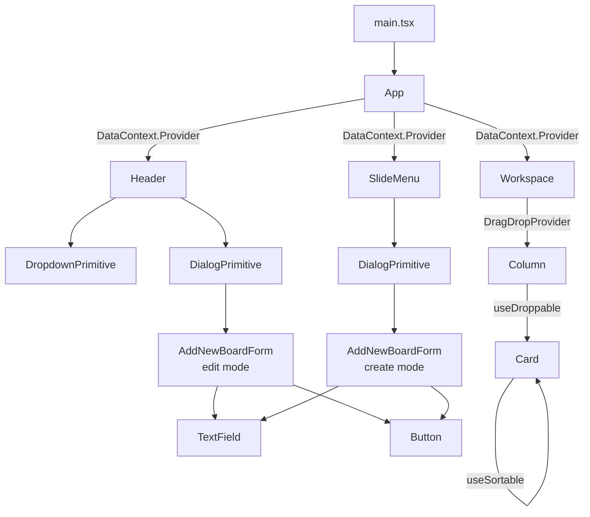

# Kanban Board

> A task-management board built with React 19, TypeScript and Vite. You can create boards, add columns and tasks, edit them inline, and drag and drop cards within a column or between columns. All data is saved in the browser.


## 🎬 Demo


▶️ **Full walkthrough with voice-over (Egyptian Arabic, 2 min).** Press play below to watch it with sound:

<!--
  HOW TO SHOW THE FULL VIDEO WITH SOUND (one time, about 1 minute):
  1. Open this README on GitHub and click the ✏️ (Edit) button.
  2. Drag the file "Kanban_Board_Demo_EG.mp4" from your computer and drop it on the line below this comment.
  3. GitHub uploads it and inserts a link like https://github.com/user-attachments/assets/xxxxxxxx
     Keep that link alone on its own line: GitHub turns it into a video player right inside the README.
  4. Click "Commit changes".
  (A video file committed inside the repository will NOT play in the README; it must be uploaded this way.)
-->


---

## Table of Contents

- [Demo](#-demo)
- [About the Project](#about-the-project)
- [Features](#features)
- [Tech Stack](#tech-stack)
- [Getting Started](#getting-started)
  - [Prerequisites](#prerequisites)
  - [Installation](#installation)
  - [Available Scripts](#available-scripts)
- [Usage](#usage)
- [Project Structure](#project-structure)
- [Architecture](#architecture)
  - [Component Tree](#component-tree)
  - [Data Model](#data-model)
  - [State Management](#state-management)
  - [Data Persistence](#data-persistence)
  - [Drag and Drop](#drag-and-drop)
- [Components Reference](#components-reference)
- [Styling](#styling)
- [Known Limitations and Roadmap](#known-limitations-and-roadmap)
- [Contributing](#contributing)
- [License](#license)
- [Acknowledgments](#acknowledgments)

---

## About the Project

This is a single-page Kanban app. Work is organised as **boards**, each board holds **columns** (for example *TODO*, *IN PROGRESS*, *DONE*), and each column holds **tasks** (cards).

The project is written as a learning exercise in modern React. It uses:

- **React Context** for shared state, without an external state library.
- Immutable updates with spread syntax and **Immer**.
- Accessible, unstyled UI primitives from **Radix UI** (dialog and dropdown menu).
- Typed component variants with **class-variance-authority**.
- Sortable drag and drop with **dnd-kit**.

It has no backend. Everything is stored in the browser's `localStorage`.

---

## Features

| Area | What you can do |
| --- | --- |
| **Boards** | Create a board, switch between boards from the side menu, rename or delete the current board |
| **Columns** | Add columns when creating or editing a board, add a column from the workspace, delete a column (hover → *Delete*) |
| **Tasks** | Add a task to any column, edit the title or description inline (click the text), delete a task (hover → *Delete*) |
| **Drag and drop** | Reorder tasks inside a column, move tasks to another column (including an empty one), press <kbd>Esc</kbd> mid-drag to cancel |
| **Persistence** | All changes are saved to `localStorage` and restored on page reload |

---

## Tech Stack

| Category | Library | Purpose |
| --- | --- | --- |
| UI | [React 19](https://react.dev/) | Component library |
| Language | [TypeScript 5.9](https://www.typescriptlang.org/) | Static typing |
| Build tool | [Vite 8](https://vite.dev/) | Dev server with HMR and production bundler |
| Styling | [Tailwind CSS 4](https://tailwindcss.com/) | Utility-first CSS, with custom theme tokens in `App.css` |
| Component variants | [class-variance-authority](https://cva.style/) + [clsx](https://github.com/lukeed/clsx) | Typed `variant` / `size` props and conditional class names |
| UI primitives | [Radix UI](https://www.radix-ui.com/) | Accessible `Dialog` and `DropdownMenu` |
| Icons | [@radix-ui/react-icons](https://www.radix-ui.com/icons) | Icons such as the "more" (⋮) menu trigger |
| Immutable state | [Immer](https://immerjs.github.io/immer/) | Simpler nested updates when editing a task |
| Drag and drop | [@dnd-kit/react](https://dndkit.com/) + `@dnd-kit/helpers` + `@dnd-kit/abstract` | Sortable cards and droppable columns |
| Linting | [ESLint 10](https://eslint.org/) + `typescript-eslint` + React Hooks plugin | Code quality |

---

## Getting Started

### Prerequisites

- **Node.js** `20.19+` or `22.12+`. Vite 8 needs one of these versions.
- **npm**, which comes with Node.js.

Check your versions:

```bash
node -v
npm -v
```

### Installation

```bash
# 1. Clone the repository (or unzip the project folder)
git clone <your-repo-url> kanban-board
cd kanban-board

# 2. Install dependencies
npm install

# 3. Start the development server
npm run dev
```

Then open the URL printed in the terminal (usually <http://localhost:5173>).

### Available Scripts

| Command | Description |
| --- | --- |
| `npm run dev` | Starts the Vite dev server with Hot Module Replacement |
| `npm run build` | Type-checks the project (`tsc -b`), then builds an optimised bundle into `dist/` |
| `npm run preview` | Serves the production build from `dist/` locally, to test it before deploying |
| `npm run lint` | Runs ESLint on the whole project |

---

## Usage

1. **Create a board.** Click **+ Create New Board** in the side menu, give it a name, add one or more column names, then click **Create New Board**.
2. **Switch boards.** Click any board name under **All Boards**.
3. **Edit or delete a board.** Open the **⋮** menu in the header and choose **Edit Board** or **Delete Board**.
4. **Add a column.** Click **+ Add new Column** at the end of the workspace.
5. **Add a task.** Click **+ Add New Task** at the bottom of a column.
6. **Edit a task.** Click its title or description. The text turns into a text area, and your change is saved when you click outside it.
7. **Delete a task or column.** Hover over it and click **Delete**.
8. **Move a task.** Press on an empty area of the card (not on its title or description text, which are buttons), then drag it to a new position in the same column or into another column. Press <kbd>Esc</kbd> while dragging to cancel.

> **Tip, sample data:** `src/data.json` contains three example boards. The app does not load this file automatically: it starts from `localStorage`. To load the samples, paste the file's contents into the browser console like this and reload the page:
>
> ```js
> localStorage.setItem("data", JSON.stringify(/* paste data.json here */));
> ```

---

## Project Structure

```text
kanban-board/
├── docs/
│   ├── demo.gif                # Animated demo shown at the top of this README
│   └── screenshot.png          # Static screenshot
├── public/                     # Static files served as-is at the site root
│   ├── favicon.svg             # Browser tab icon
│   └── icons.svg               # SVG sprite (from the Vite template)
├── src/
│   ├── assets/                 # Images imported by components (bundled by Vite)
│   │   ├── icon-board.svg      # Board icon in the side menu
│   │   ├── icon-cross.svg      # "Remove column" icon in the board form
│   │   └── hero.png, react.svg, vite.svg   # Leftovers from the Vite template
│   ├── components/
│   │   ├── AddNewBoardForm.tsx # Form to create or edit a board and its columns
│   │   ├── Button.tsx          # Reusable button with cva variants (primary / secondary / destructive)
│   │   ├── Card.tsx            # A task card: inline editing, delete, sortable drag and drop
│   │   ├── Column.tsx          # A column: header, list of cards, add task, delete, drop zone
│   │   ├── DialogPrimitive.tsx # Wrapper around Radix Dialog (modal)
│   │   ├── DropdownPrimitive.tsx # Wrapper around Radix DropdownMenu
│   │   ├── Header.tsx          # Top bar: logo, board title, ⋮ menu (edit / delete board)
│   │   ├── SlideMenu.tsx       # Left sidebar: list of boards and "Create New Board"
│   │   ├── TextField.tsx       # Reusable text input with an invalid state
│   │   └── Workspace.tsx       # Renders the columns of the selected board; hosts DragDropProvider
│   ├── App.css                 # Tailwind import, theme tokens (@theme), typography utilities
│   ├── App.tsx                 # Root component: state, localStorage sync, layout
│   ├── DataContext.ts          # React Context + Board / DataContextType types
│   ├── data.json               # Sample boards (see the Usage tip)
│   ├── index.css               # Global base styles and CSS variables (light / dark)
│   └── main.tsx                # Entry point: mounts <App /> in <StrictMode>
├── eslint.config.js            # ESLint flat config
├── index.html                  # HTML shell; Vite injects the bundle here
├── package.json                # Dependencies and npm scripts
├── tsconfig.json               # TypeScript project references
├── tsconfig.app.json           # TS options for the app code (src/)
├── tsconfig.node.json          # TS options for config files (vite.config.ts)
└── vite.config.ts              # Vite config: React and Tailwind plugins
```

---

## Architecture

### Component Tree



### Data Model

All data is one array of boards. The types live in `DataContext.ts`, `Column.tsx` and `Card.tsx`:

```ts
interface Board {
  id: number;
  title: string;
  columns: ColumnProps[];
}

interface ColumnProps {
  id: number;
  title: string;
  tasks: Task[];
  columnindex: number;   // position of the column on the board
}

interface Task {
  id: number;
  title: string;
  description: string;
  columnId: number;      // id of the column the task belongs to
  columnIndex: number;   // position of that column
  cardIndex: number;     // position of the task inside the column
}
```

Example:

```json
[
  {
    "id": 1,
    "title": "board1",
    "columns": [
      {
        "id": 1,
        "title": "TODO",
        "tasks": [{ "id": 1, "title": "card1", "description": "card1 description" }]
      }
    ]
  }
]
```

New ids are created with `Date.now()`.

### State Management

The app uses a single source of truth held in `App.tsx` and shared through **React Context**:

```ts
interface DataContextType {
  data: Board[];                                       // every board
  setData: Dispatch<SetStateAction<Board[]>>;          // update the boards
  selectedBoardIndex: number;                          // which board is shown
  setSelectedBoardIndex: Dispatch<SetStateAction<number>>;
}
```

Any component can call `useContext(DataContext)` to read or update the data. All updates are **immutable**: they copy arrays and objects with spread syntax, or use Immer's `produce` in `Card.tsx`. This lets React detect the change and re-render.

### Data Persistence

```text
App mounts ──► useState(() => JSON.parse(localStorage.getItem("data")) ?? [])
any setData ──► useEffect([dataState]) ──► localStorage.setItem("data", JSON.stringify(dataState))
```

- **Lazy initial state.** `localStorage` is read only once, on the first render.
- **Safe parsing.** If the stored JSON is corrupted, the app falls back to an empty array.
- **Automatic saving.** Every change to `data` is written back automatically.

### Drag and Drop

Drag and drop uses the new `@dnd-kit/react` API, following the official [Multiple sortable lists](https://dndkit.com/react/guides/multiple-sortable-lists) guide.

| Piece | File | Role |
| --- | --- | --- |
| `DragDropProvider` | `Workspace.tsx` | Creates the drag-and-drop manager and listens to `onDragStart`, `onDragOver` and `onDragEnd` |
| `useSortable` | `Card.tsx` | Makes each card draggable and sortable (`id: task-<id>`, `group: column-<columnId>`, `type/accept: "task"`) |
| `useDroppable` | `Column.tsx` | Makes each column a drop zone (`id: column-<id>`) so empty columns can receive cards. It uses `CollisionPriority.Low` so cards are preferred over their column |
| `move()` | `@dnd-kit/helpers` | Calculates the new order of the cards |

**How a drag works:**

1. **`onDragStart`** saves a snapshot of the data in a `useRef`.
2. **`onDragOver`** fires while the card moves. Each time, it:
   - builds a record of the current board, shaped like `{ "column-1": ["task-1", "task-2"], ... }`;
   - calls `move(record, event)` to get the new order;
   - maps the ids back to the full task objects and calls `setData`.
3. **`onDragEnd`**: if the drag was **cancelled** (<kbd>Esc</kbd>), it restores the snapshot. Otherwise the data is already in its final order and is saved automatically.

Ids have a `task-` or `column-` prefix because a column and a task can share the same numeric id, and dnd-kit needs ids to be unique.

---

## Components Reference

| Component | Props | Description |
| --- | --- | --- |
| `App` | — | Owns the `data` and `selectedBoardIndex` state, syncs `localStorage`, and renders the layout inside `DataContext.Provider` |
| `Header` | — | Shows the app logo and the board header. Its ⋮ dropdown opens the **Edit Board** dialog or deletes the board after confirmation |
| `SlideMenu` | — | Lists all boards (highlighting the selected one) and opens the **Create New Board** dialog |
| `Workspace` | — | Renders the selected board's columns plus the **+ Add new Column** button. Hosts `DragDropProvider` |
| `Column` | `id`, `title`, `tasks`, `columnindex` | Column header with a task count, its cards, **+ Add New Task**, and a hover **Delete**. Registered as a drop zone |
| `Card` | `id`, `title`, `description`, `columnId`, `columnIndex`, `cardIndex` | Task card with click-to-edit title and description (saved on blur) and a hover **Delete**. Sortable, with dragging turned off while editing |
| `AddNewBoardForm` | `toggleDialog`, `boardId?`, `title?`, `columns?` | Form to **create** a board (no `boardId`) or **edit** one (with `boardId`). Lets you add or remove column fields |
| `DialogPrimitive` | `title`, `isOpen`, `setOpen`, `children`, `triggerComponent?` | Controlled Radix `Dialog` with an overlay and a centred panel |
| `DropdownPrimitive` | `trigger`, `items: { label, onClick, disabled? }[]` | Radix `DropdownMenu`. Items with "delete" in their label are shown in red |
| `Button` | `variant` (`primary` \| `secondary` \| `destructive`), `size` (`sm` \| `lg`), `isFullWidth`, `isDisabled`, plus all native button props | Styled button built with `cva` |
| `TextField` | `name`, `placeholder?`, `defaultValue?`, `value?`, `required?`, `isInvalid?` | Uncontrolled text input. Shows *"Can't be empty"* when `isInvalid` is true |

---

## Styling

- **Tailwind CSS v4** is loaded through the `@tailwindcss/vite` plugin (see `vite.config.ts`).
- **Design tokens** are declared in `App.css` inside `@theme`. Tailwind turns them into utility classes such as `bg-main-purple`, `text-medium-grey` and `text-red`:

  | Token | Value |
  | --- | --- |
  | `--color-main-purple` | `#635FC7` |
  | `--color-main-purple-hover` | `#A8A4FF` |
  | `--color-medium-grey` | `#828FA3` |
  | `--color-light-grey` | `#F4F7FD` |
  | `--color-red` | `#EA5555` |

- **Global styles and CSS variables** for light and dark mode are in `index.css`.
- **Component variants** (for example on `Button`) are defined once with `cva`, so styling stays consistent and type-safe.

---

## Known Limitations and Roadmap

- [x] Drag and drop of tasks within and between columns
- [ ] The header title is hard-coded as *"Platform Launch"*. It should show the selected board's title.
- [ ] `src/data.json` is not loaded on first run. It could be used as the default when `localStorage` is empty.
- [ ] Cards cannot be dragged from their title or description, because those are buttons. A dedicated drag handle would help.
- [ ] Reorder columns by drag and drop
- [ ] Form validation (empty board or column names) using `TextField`'s `isInvalid`
- [ ] Dark-mode toggle using the existing dark theme tokens
- [ ] Responsive layout for mobile, where the sidebar becomes a slide-out menu
- [ ] Unit tests (Vitest + React Testing Library)
- [ ] Remove unused Vite template assets (`hero.png`, `react.svg`, `vite.svg`)

---

## Contributing

Contributions, issues and feature requests are welcome.

1. Fork the project.
2. Create a feature branch: `git checkout -b feature/my-feature`
3. Commit your changes: `git commit -m "feat: add my feature"`
4. Make sure `npm run lint` and `npm run build` pass.
5. Push the branch: `git push origin feature/my-feature`
6. Open a Pull Request.

Please follow the existing code style: function components, typed props, immutable state updates, and Tailwind utility classes.

---

## License

No license has been chosen yet. Until one is added, all rights are reserved by the author. To make the project open source, add a `LICENSE` file (for example [MIT](https://choosealicense.com/licenses/mit/)) and update this section.

---

## Acknowledgments

- [Frontend Mentor: Kanban task management challenge](https://www.frontendmentor.io/), which inspired the layout and colour palette
- [dnd-kit](https://dndkit.com/) for the drag-and-drop toolkit
- [Radix UI](https://www.radix-ui.com/) for accessible primitives
- [Vite](https://vite.dev/) and [Tailwind CSS](https://tailwindcss.com/)
